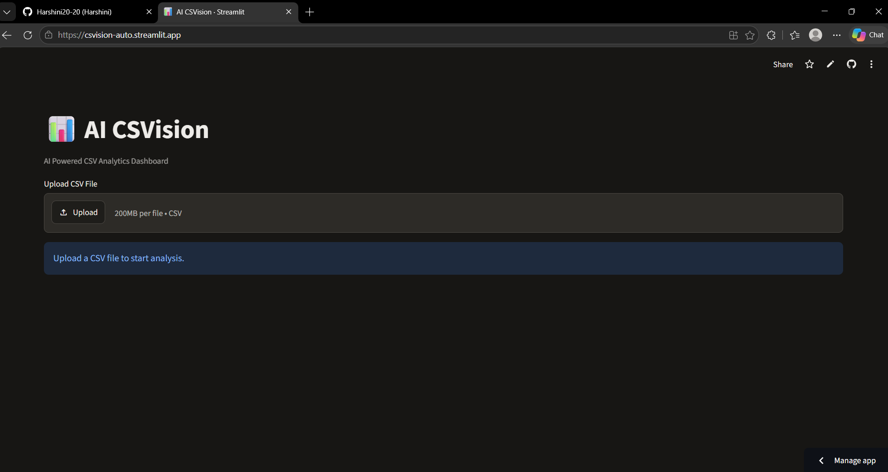
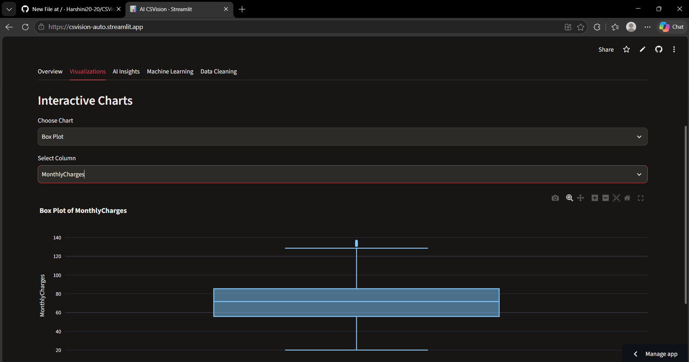
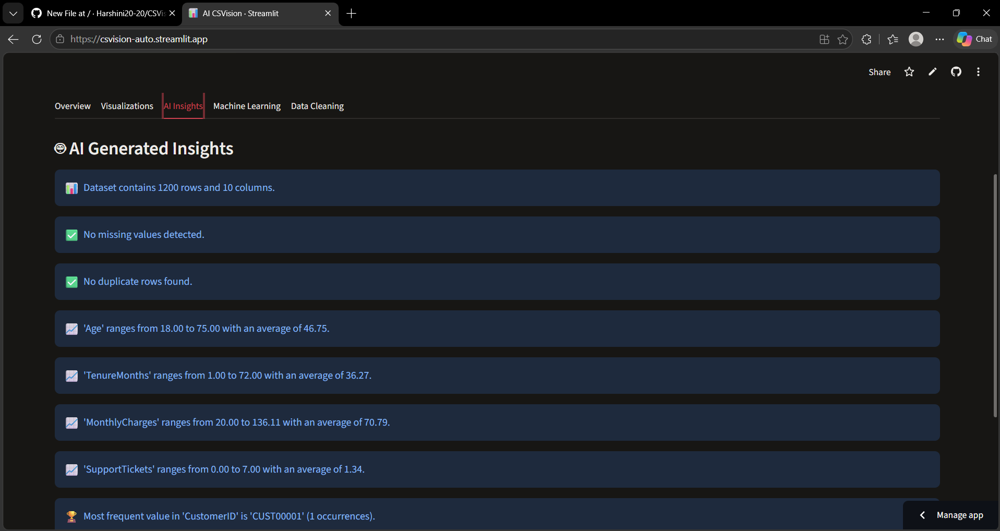
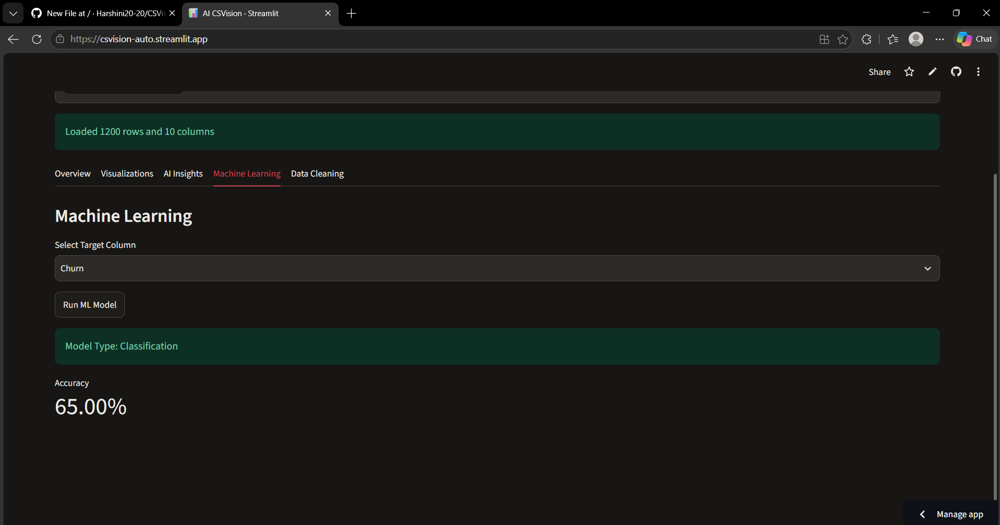

# 📊 AI CSVision — AI-Powered CSV Analytics Dashboard

<p align="center">
  <b>Transform raw CSV data into meaningful insights.</b>
  <br/>
  An interactive analytics platform for data exploration, visualization, automated insights, and machine learning.
</p>

<p align="center">
  <a href="https://csvision-auto.streamlit.app/">
    
  </a>
  <a href="https://github.com/Harshini20-20/AI-powered-CSV-analyzer-with-visualization">
    
  </a>
</p>

---

## 🚀 Overview

**AI CSVision** is a Python-based interactive data analytics application built using Streamlit. It enables users to upload CSV datasets and perform exploratory data analysis, generate automated statistical insights, visualize patterns, execute machine learning models, and clean datasets through a unified dashboard.

The application simplifies the initial stages of data analysis by bringing multiple data-processing and machine-learning capabilities into one interface.

## ✨ Key Features

### 📁 1. Dataset Overview
- Upload CSV files directly through the dashboard.
- Preview uploaded datasets.
- Display dataset dimensions (rows and columns).
- Inspect dataset structure and column information.

### 📊 2. Interactive Data Visualization
Explore datasets through interactive charts:
- Histograms
- Scatter plots
- Box plots
- Pie charts
- Correlation heatmaps

### 🤖 3. Automated AI-Generated Insights
Generate readable, dataset-specific insights through automated statistical analysis.

- Dataset dimensions and structure.
- Missing-value detection.
- Duplicate record identification.
- Numerical column statistics.
- Minimum, maximum, and average values.
- Frequent categorical values.
- Correlation analysis.

### 🧠 4. Machine Learning
Train machine learning models using uploaded datasets.

- Random Forest Classification.
- Random Forest Regression.
- Target-column selection.
- Automatic classification or regression task selection based on target type.
- Categorical feature encoding.
- Model evaluation using Accuracy and R² Score.

### 🧹 5. Data Cleaning
- Remove duplicate records.
- Remove rows containing missing values.
- Export cleaned datasets in CSV format.

### 📑 6. Automated Report Generation
Generate downloadable analysis reports:
- Excel reports.
- PowerPoint presentations.

---

## 🖥️ Application Screenshots

### Dataset Overview
Preview uploaded datasets and explore their structure.



### Interactive Visualizations
Explore numerical and categorical data through interactive charts.



### AI-Generated Insights
View automatically generated statistical insights and dataset observations.



### Machine Learning
Run classification and regression models on uploaded datasets.



---

## 🛠️ Technology Stack

| Category | Technologies |
|---|---|
| Programming Language | Python |
| Web Framework | Streamlit |
| Data Processing | Pandas, NumPy |
| Machine Learning | Scikit-learn |
| Visualization | Plotly, Matplotlib, Seaborn |
| Excel Reporting | XlsxWriter, OpenPyXL |
| PowerPoint Reporting | Python-PPTX |

## 🏗️ Project Architecture

```text
AI-powered-CSV-analyzer-with-visualization/
│
├── app.py             # Main Streamlit application
├── charts.py          # Interactive visualization module
├── insights.py        # Automated statistical insights
├── ml_models.py       # Machine learning models
├── reports.py         # Excel and PowerPoint reports
├── utils.py           # Utility functions
├── requirements.txt   # Project dependencies
├── assets/            # Application screenshots
│   ├── overview.png
│   ├── visualizations.png
│   ├── ai-insights.png
│   └── machine-learning.png
│
└── README.md
```

## ⚙️ Installation and Setup

### Prerequisites
- Python
- Git
- pip

### 1. Clone the Repository

```bash
git clone https://github.com/Harshini20-20/AI-powered-CSV-analyzer-with-visualization.git
```

### 2. Navigate to the Project Directory

```bash
cd AI-powered-CSV-analyzer-with-visualization
```

### 3. Create a Virtual Environment

```bash
python -m venv venv
```

Activate the environment on Windows:

```bash
venv\Scripts\activate
```

### 4. Install Dependencies

```bash
pip install -r requirements.txt
```

### 5. Run the Application

```bash
streamlit run app.py
```

The application will automatically open in your default browser.

## 🔄 Application Workflow

1. Upload a CSV dataset.
2. Preview and explore dataset information.
3. Generate interactive visualizations.
4. View automated statistical insights.
5. Select a target column and execute a machine learning model.
6. Clean the dataset by handling duplicates and missing records.
7. Generate and download Excel or PowerPoint reports.

## 🌐 Live Application

Try CSVision here:

**[https://csvision-auto.streamlit.app/](https://csvision-auto.streamlit.app/)**

## 🔮 Future Scope

Potential areas for further development:

- Natural-language querying of datasets.
- Additional machine learning algorithms.
- Advanced data preprocessing.
- Enhanced analytical reporting.
- More customizable visualizations.

## 👩‍💻 Author

**Harshini G**

- GitHub: [Harshini20-20](https://github.com/Harshini20-20)

---

<p align="center">
  Built with ❤️ using Python and Streamlit.
</p>
